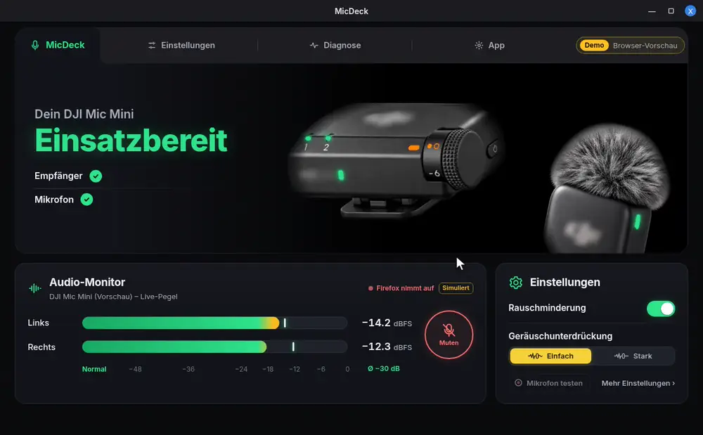
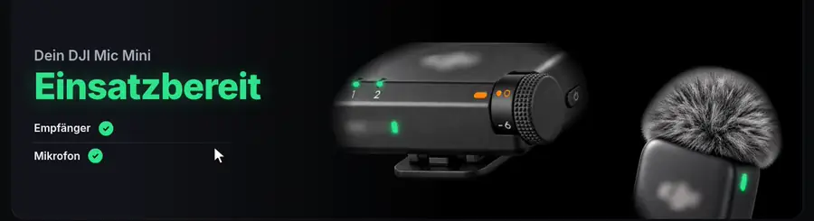
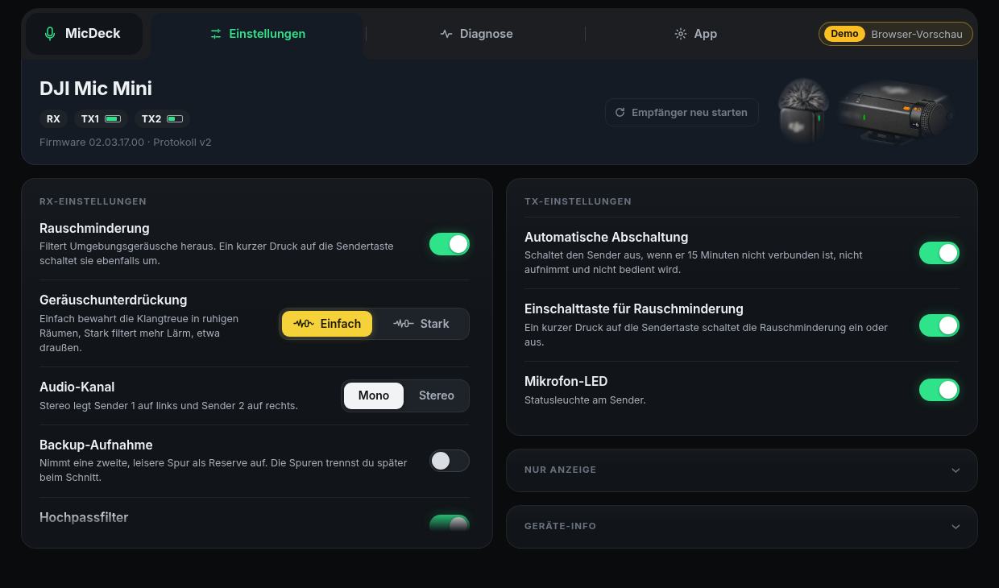
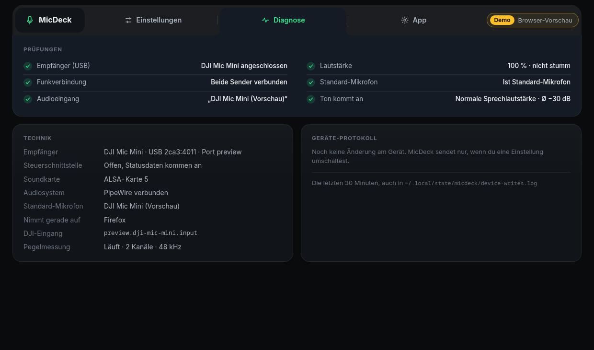
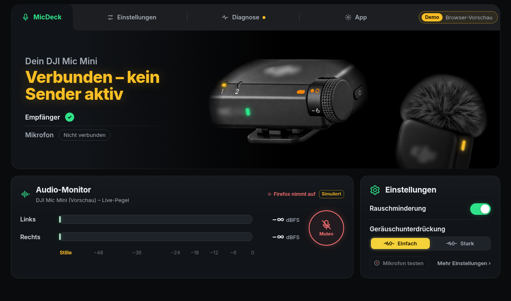
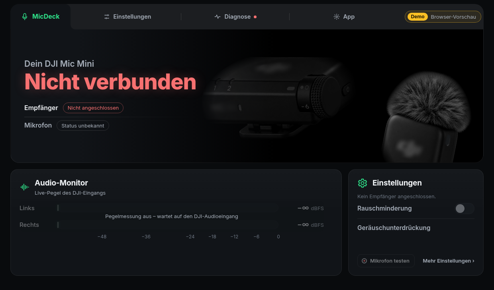

# MicDeck <a href="README.en.md"></a><a href="README.md"></a>

**The Linux app for the DJI Mic Mini: one glance tells you whether receiver and mic are on and whether sound is actually reaching your PC.**

<p align="center">   </p>

<p align="center"></p>

DJI ships no Linux app for the Mic Mini. MicDeck fills the gap: it reads the receiver over USB, checks in PipeWire whether the sound really arrives, and boils it all down to one traffic light. Green means: start talking, you're good. On top of that you switch noise cancelling, mono/stereo and friends like in DJI's phone app, just on your PC.

> **Unofficial, use at your own risk.** MicDeck is an independent hobby project, not affiliated with DJI or Anthropic. "DJI" and "DJI Mic Mini" only name the device it works with. MicDeck can change settings on the receiver and transmitter. It only sends commands that were tested on real hardware, but it comes without any warranty (see the licenses).

The interface is German only for now.

<details>
<summary><b>🚀 Quick start</b></summary>

There are no prebuilt packages yet. Build an RPM for Fedora like this:

```bash
sudo dnf install webkit2gtk4.1-devel librsvg2-devel libxdo-devel pipewire-devel clang rust cargo nodejs
npm install --global pnpm    # if pnpm is missing
pnpm -C app install
pnpm -C app tauri build --bundles rpm
sudo dnf install target/release/bundle/rpm/MicDeck-*.rpm
```

Then plug in the receiver, start MicDeck from the menu, done. On Cinnamon MicDeck looks best as an applet: right-click the panel → **Applets** → add **MicDeck**. Without the applet you get a regular panel icon.

**Laid-back kind of person?** Just hand this prompt to your AI agent (Claude Code or Codex on your PC, for example). It checks what's already there and what's missing, and asks you before it changes anything.

```text
Help me set up MicDeck (github.com/Hendrik4K/micdeck) on this Linux PC so I can monitor and configure my DJI Mic Mini from the desktop.
Only check at first and ask me before every change:
1. Which distribution and desktop is this? Is PipeWire with WirePlumber running (`wpctl status`)?
2. Are Rust 1.90 or newer, Node.js, pnpm, clang and the development packages for WebKitGTK 4.1, librsvg, libxdo and PipeWire installed? Tell me what's missing and which command installs it. Run `sudo` commands only after my OK; I type the password myself.
3. Clone the repository, run `cargo test --workspace`, then build the package with `pnpm -C app install` and `pnpm -C app tauri build --bundles rpm` (on Fedora; otherwise tell me which package format fits).
4. Install the package only after my OK. It includes a udev rule that gives only the logged-in user access to the receiver.
5. When I plug in the receiver, check with `lsusb | grep 2ca3` that it is detected and with `wpctl status` that its audio input is there.
6. If I use Cinnamon, explain how to add the MicDeck applet to the panel. Don't change panel settings yourself.
7. Finally, tell me how to start MicDeck and how I can tell that everything is green.
```

**Build and hack on it yourself:** Rust 1.90 or newer and Node.js with pnpm, then in the project folder:

```bash
pnpm -C app install
cargo test --workspace
pnpm -C app tauri dev                 # with a real receiver
pnpm -C app tauri dev -- -- --demo    # demo mode without a device
pnpm -C app dev                       # interface only, in the browser at http://127.0.0.1:1420
```

Without the `clang` package, libclang doesn't find its own headers (`stdbool.h`) while generating the PipeWire bindings. As a workaround `.cargo/config.toml` points to `/usr/lib/clang/22/include`; adjust the number if your clang version differs.

</details>

<details>
<summary><b>💡 What it does</b></summary>

- **Traffic light at a glance**<br>Green (ready), yellow (connected, but e.g. muted, no sound or not the default input), red (not connected). Every state comes with a check list and a concrete fix.
- **Panel menu on hover**<br>On Cinnamon, hovering the icon opens a menu: status, live level, mute and the most important switches. A click on the icon opens MicDeck. While a program is recording, the icon pulses.
- **Device settings like DJI's app**<br>Noise cancelling (on/off, basic/strong), mono/stereo, backup recording, low cut, clipping control, auto power-off, power with the camera, transmitter button, transmitter LED. A change only counts once the receiver acknowledges it **and** reports the new value.
- **Live level**<br>In dBFS, with a clipping indicator and loudness in words. Measured in memory only, while a meter is visible.
- **Big mute button**<br>Flips the mute switch inside the receiver itself, so no program gets sound. If another program lifts the mute, MicDeck warns you.
- **Microphone test**<br>Just talk: MicDeck records until you pause briefly and plays it back to you. Nothing is stored.
- **Charging-case tricks**<br>Shows "charging" while the transmitter sits in its case. Optional: mute while in the case. And experimental: taking the transmitter out starts dictation in the Claude app, putting it back sends the message.
- **Plug, unplug, replug**<br>All while running, no restart.
- **Device pictures**<br>MicDeck ships pictures of the receiver and transmitter (AI-generated, logos blurred). Rest the pointer on a device for about 5 seconds until the ring closes, click "PNG hochladen" and drop in your own photo. "Standard" brings the built-in picture back.

<ins>Why it exists:</ins> DJI ships no Linux app, and the existing community tools ([DJI-Mic-Control](https://github.com/ShadowBitBasher/DJI-Mic-Control), [dji-mic-mo](https://github.com/usokawa/dji-mic-mo)) talk to the receiver but don't check the part that usually goes wrong on Linux: whether the sound really reaches PipeWire.

</details>

<details>
<summary><b>📷 More pictures</b></summary>

<p align="center"></p>

<p align="center"></p>

| Device settings | Diagnostics |
|---|---|
|  |  |
| **Receiver on, no transmitter** | **Not connected** |
|  |  |

*All pictures and animations show demo data from the browser preview, no real measurements. Desktop and panel in the first animation are staged.*

</details>

<details>
<summary><b>🧰 Requirements</b></summary>

**Tested:** DJI Mic Mini (receiver USB `2ca3:4011`, firmware 02.03.17.00 and earlier 01.01.00.56), one transmitter, Fedora 44 with Cinnamon on X11, PipeWire 1.6, WirePlumber 0.5.

**Not tested:** DJI Mic Mini 2 / 2S, two transmitters at once, Wayland, other desktops. Reports and fixes are welcome.

**USB access:** sound and level work without it. To read the receiver's status data (transmitters connected, battery, settings) MicDeck needs access to this one USB device. The RPM installs `packaging/70-micdeck.rules`, which grants it only to the user logged in at the computer (`uaccess`): no `0666`, no extra group. By hand:

```bash
sudo install -m 0644 packaging/70-micdeck.rules /etc/udev/rules.d/70-micdeck.rules
sudo udevadm control --reload-rules
sudo udevadm trigger --subsystem-match=usb --attr-match=idVendor=2ca3
```

**For charging-case dictation:** X11, the Claude desktop app and its dictation shortcut left at the default **Ctrl+D**.

</details>

<details>
<summary><b>🎛️ Using it in detail</b></summary>

- **Pages:** *MicDeck* (device stage, audio monitor with mute button and microphone test, quick settings), *Settings*, *Diagnostics* and *App*. `micdeck --page=device` opens a page directly (`overview`, `device`, `diagnose`, `app`).
- **Panel:** with the Cinnamon applet, hovering opens the menu; a click on the icon, the picture or the gear opens MicDeck. Without the applet there is a regular panel icon with a right-click menu. Closing the window hides MicDeck in the panel.
- **What MicDeck never sends:** the plug-free external speaker (restarts the receiver, change it in DJI's app), voice tone (Mic Mini 2 only), gain (dial only, shown read-only), firmware updates (DJI's app only). The same rules as in DJI's app apply: backup recording only in mono, basic/strong only with noise cancelling on, transmitter settings only with a transmitter switched on. With a single transmitter MicDeck stays in mono.
- **Device log:** every step of a change is listed for 30 minutes under *Diagnostics* and in `~/.local/state/micdeck/device-writes.log`.
- **Your own device pictures:** rest the pointer on a device for 5 seconds and choose "PNG hochladen" (WebP or JPEG work too, ideally cut out, at most 10 MB). MicDeck copies the picture into `~/.config/micdeck/devices/`, so the original can go. The previous picture stays there as `receiver-vorher.png` or `transmitter-vorher.png`. By hand: put `receiver.png` and `transmitter.png` into that folder and restart MicDeck. An optional `leds.json` in the same folder places the status lights, in percent of each picture:
  `{"receiver": {"power": [25, 56], "unit1": [13, 24], "unit2": [22, 27]}, "transmitter": {"status": [76, 56]}}`
- **Mute while in the case:** transmitter 1 into the case mutes, taking it out unmutes. If a program (a browser, say) starts recording meanwhile, MicDeck lifts the mute just for that and mutes again 2 s after it ends. A mute you set yourself is never lifted.
- **Charging-case dictation (experimental):** taking transmitter 1 out brings the Claude window to the front and presses Ctrl+D. Putting it back waits 1 s for the end of your sentence, presses Ctrl+D, waits 2 s for the text and sends it with Enter. Keys only ever go to the Claude window; if it can't be brought to the front, nothing happens.
- **Start at login** creates `~/.config/autostart/micdeck.desktop` (panel only) and removes it when switched off. Settings live in `~/.config/micdeck/settings.json`.
- **Demo mode:** `micdeck --demo` cycles through all twelve scenarios, `micdeck --demo=no-transmitter` shows one.
- **Debugging:** `RUST_LOG=info,usb_link=debug,audio_pw=debug micdeck`; `usb_link=trace` also prints every status frame from the receiver as hex.

</details>

<details>
<summary><b>🔒 Privacy</b></summary>

No accounts, no cloud, no telemetry. Audio is processed in memory only for the level meter and the microphone test, and is never stored or sent anywhere. MicDeck only writes settings you switch yourself to the device, and never firmware.

</details>

<details>
<summary><b>🧪 Test status</b></summary>

| Part | Status |
|---|---|
| Automated tests (protocol, readiness rules, setting rules, level maths, speech detection, PipeWire, charging case) | ✅ 115 passed |
| All 11 writable settings switched and restored on real hardware, each acknowledged and read back within 0.1–0.2 s | ✅ firmware 02.03.17.00 |
| Plug, unplug, replug while running | ✅ on the device |
| Mute button flips the receiver's switch, warning when another program unmutes | ✅ on the device |
| Charging-case dictation with the Claude app | ✅ on the device |
| Cinnamon applet: menu on hover, click opens MicDeck, live level | ✅ Cinnamon 6.6 |
| Two transmitters at once, real programs like OBS or Discord in parallel | ⏳ not tested yet |

Check the write path yourself with `cargo run -p usb-link --example settings_roundtrip` (quit MicDeck first; every value is restored).

</details>

<details>
<summary><b>🛠️ Layout and protocol</b></summary>

```
crates/dji-protocol   DJI status protocol (vendored from DJI-Mic-Control, see THIRD_PARTY.md)
crates/micdeck-core   state, readiness rules, level maths, demo scenarios, no hardware access
crates/usb-link       USB: hot-plug, permissions, status frames, setting changes
crates/audio-pw       PipeWire: inputs, default input, mute, level meter
app/src-tauri         Tauri app, panel, D-Bus interface for the applet, dictation
app/src               interface (Svelte 5 + TypeScript)
packaging/            udev rule, Cinnamon applet
docs/                 protocol notes, pictures
```

The receiver's status protocol is documented in [docs/protocol/PROTOCOL.md](docs/protocol/PROTOCOL.md) (from DJI-Mic-Control). MicDeck adds one finding from real hardware: on v1 firmware, bit `0x02` of a transmitter's flags byte is set while it sits in the charging case (`0x26` docked, `0x24` taken out), the same bit v2 firmware reports as "charging".

</details>

## License

MicDeck is licensed under either of [MIT](LICENSE-MIT) or [Apache-2.0](LICENSE-APACHE), at your option. `crates/dji-protocol` is The Unlicense (public domain), as in its upstream. Third-party components, the AI-generated pictures and what was changed are listed in [THIRD_PARTY.md](THIRD_PARTY.md).
