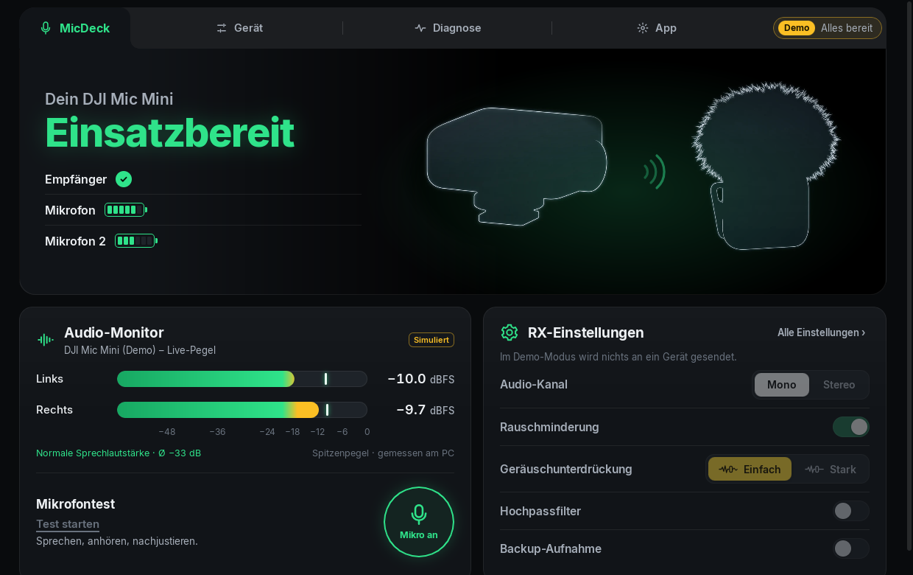
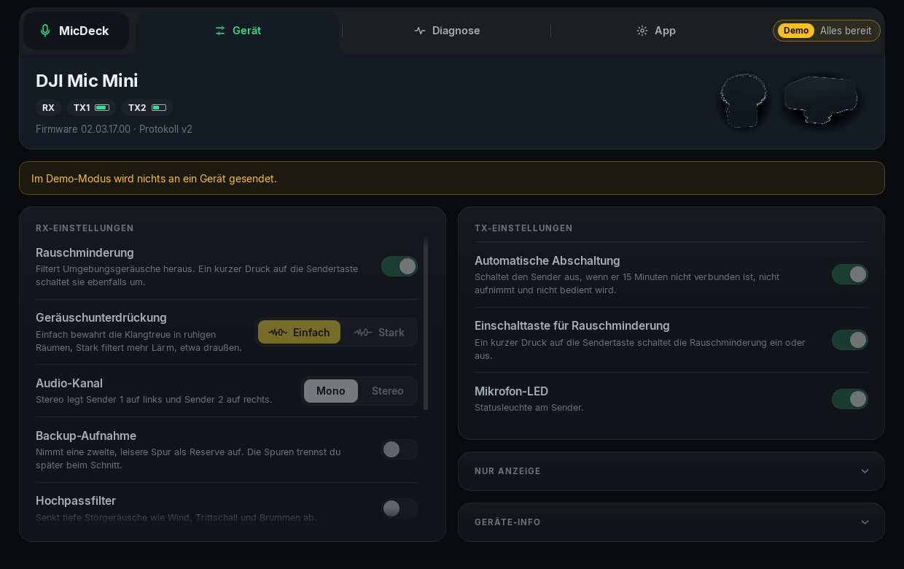
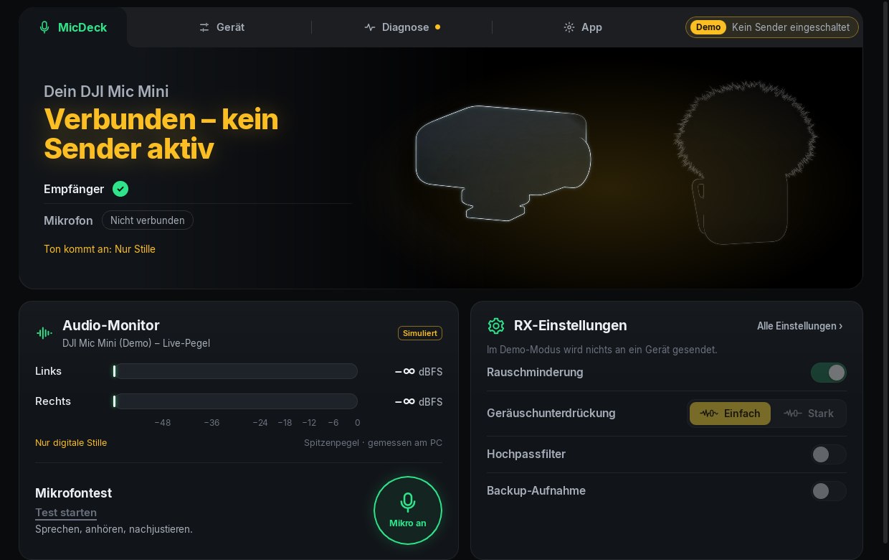
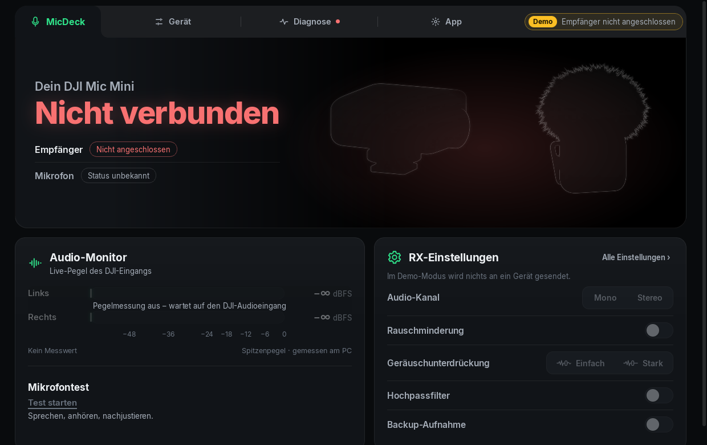

# MicDeck

A small Linux companion app for the **DJI Mic Mini** wireless microphone. It answers one question at a
glance: *is my microphone connected, switched on, and is sound actually arriving at the PC?*

> **Unofficial.** MicDeck is an independent hobby project. It is not affiliated with, endorsed by or
> supported by DJI or Anthropic. "DJI" and "DJI Mic Mini" are used only to name the device it works
> with.
>
> **Use at your own risk.** MicDeck can change settings on the receiver and transmitter. It only sends
> commands that were tested on real hardware, but it comes without any warranty (see the licenses).

[Deutsche Fassung: README.de.md](README.de.md) · The user interface is currently German only.



| Device settings | Receiver on, no transmitter | Not connected |
|---|---|---|
|  |  |  |

*Screenshots from the built-in demo mode, which is always labelled "Demo"; no real device data. In
demo mode nothing is sent to a device, so the settings are shown locked.*

## Why

DJI ships no Linux app for the Mic Mini. Existing community tools talk to the receiver's
control interface ([DJI-Mic-Control](https://github.com/ShadowBitBasher/DJI-Mic-Control),
[dji-mic-mo](https://github.com/usokawa/dji-mic-mo)), but none of them checks the part that usually
goes wrong on Linux: whether the audio really reaches PipeWire, is the default input, isn't muted, and
carries a signal. MicDeck combines both views into one traffic light.

## Features

- **One main view and three sub-pages** in a dark "precision desk" layout with a pill-shaped
  navigation bar at the top: *MicDeck* (the hardware stage with receiver and transmitters, audio
  monitor with a big mute button and the microphone test, quick receiver settings), then *Device*,
  *Diagnostics* and *App*.
- **Device settings like DJI's phone app** – noise cancelling (on/off, basic/strong), audio channel
  (mono/stereo), backup recording, low cut, clipping control, auto power-off (receiver and
  transmitter), power on with camera, transmitter button for noise cancelling, transmitter LED. A
  change only counts as done once the receiver has acknowledged it *and* reports the new value;
  every step of the last 30 minutes is listed under *Diagnostics* and in
  `~/.local/state/micdeck/device-writes.log`.
  Settings MicDeck does not send are shown, locked, with the reason (see *Changing device
  settings*).
- **Traffic light** – green (ready), yellow (connected but not fully ready, e.g. "connected but no
  sound", muted, not the default input), red (not connected or broken), grey (checking). Every state
  comes with a check list and a concrete fix.
- **Three independent sources** – USB bus (is the receiver plugged in), the receiver's status data
  (which transmitters are on, firmware, charging case), PipeWire (input present, default, muted, level).
- **Live level** in dBFS, clipping indicator and a smoothed loudness label ("quiet", "normal speech",
  "loud" …). Samples are analysed in memory only while the window is visible; nothing is recorded.
- **Hot-plug** – plug in, unplug, replug while running; no restart needed.
- **Microphone session** – press Start and just talk: recording starts when you speak and ends after
  a short pause (15 s at most), then you hear yourself. A bubble grows while you speak and drains like
  an hourglass during playback. Speak during playback to cut it short and record a new take (an echo
  check keeps loudspeaker playback from interrupting itself). Ends by itself after a few quiet
  seconds. Takes live in memory only and are never written to disk.
- **Mute button** (window and panel menu) – mutes the DJI input through WirePlumber, which on the
  Mic Mini receiver flips its own USB mute switch (`Mic Capture Switch`): from then on the receiver
  sends silence and no program gets sound, including ones that bypass PipeWire. If another program
  lifts the mute, MicDeck notifies you. (It is a software-controlled switch, not a physical one: only
  switching the transmitter off or unplugging the receiver is tamper-proof.)
- **Panel icon** (StatusNotifierItem) showing the status, with a menu; closing the window keeps MicDeck
  in the panel. Without a panel the window simply behaves like a normal app.
- **Notifications** when the receiver is unplugged, a transmitter loses its radio link for more than
  3 s, and once more when everything is ready again.
- **Charging case** – shows "charging" while a transmitter sits in its case, also on the older v1
  firmware (see *Protocol notes*). Optional: mute the input while transmitter 1 is in its case. If
  another program (a browser, say) starts recording meanwhile, MicDeck lifts the mute just for that
  recording, says so in a notification and mutes again two seconds after it ends. A mute you set
  yourself is never lifted.
- **Optional: dictation trigger for the Claude desktop app** (experimental, off by default) – take
  transmitter 1 out of its charging case and MicDeck starts dictation in the Claude window; put it
  back and it stops and sends the message. The panel icon turns into a glowing "sonar" while
  dictating, then shows a progress bar and a tick.


*Panel icon: ready · not fully ready · not connected · dictating · sending · sent.*

## Status

Tested on one setup only:

| | |
|---|---|
| Device | DJI Mic Mini receiver (USB `2ca3:4011`), firmware 02.03.17.00 (status protocol v2), one transmitter; earlier also firmware 01.01.00.56 (v1) |
| System | Fedora 44, Cinnamon on X11, PipeWire 1.6, WirePlumber 0.5 |
| Tests | 101 automated tests (protocol, readiness rules, setting rules and change tracking, level maths, speech detection, PipeWire parsing, notifications, charging-case trigger) plus a hardware round trip of every setting MicDeck sends |

Not tested: DJI Mic Mini 2 / 2S, two transmitters at once, Wayland, other desktops. Reports and fixes
are welcome.

## Changing device settings

MicDeck sends a command only when you switch a setting, one at a time, and only for the eleven
settings it lists as writable. Each change waits for the receiver's acknowledgement (sequence number
echoed, result code "accepted") and then for a status frame that reports the new value; anything else
is shown as an error ("refused", "no answer", "acknowledged but not applied"). On firmware
02.03.17.00 all eleven were switched and switched back on real hardware with
`cargo run -p usb-link --example settings_roundtrip`: every one was acknowledged and read back within
about 0.1–0.2 s.

Never sent (gain, the plug-free speaker and the firmware are shown read-only; voice tone is left out):

| Setting | Why |
|---|---|
| Plug-free external speaker | switching it restarts the receiver and cuts the audio to the PC – change it in DJI's app |
| Voice tone | DJI Mic Mini 2 only |
| Gain | set with the dial on the receiver, not over USB (shown read-only) |
| Firmware update | DJI's app only; MicDeck never touches firmware |

Settings that need firmware v2 are locked on v1 firmware, per-transmitter settings are locked while no
transmitter is on, backup recording only works in mono, and the noise-cancelling level needs noise
cancelling switched on – the same rules as DJI's app. With a single transmitter MicDeck keeps the
receiver in mono: stereo puts transmitter 1 on the left and 2 on the right, so one side would stay
silent. A switch moves at once; only a failed change shows a message (and the switch falls back).

## Install

There are no prebuilt packages yet. Build an RPM yourself (Fedora):

```bash
sudo dnf install webkit2gtk4.1-devel librsvg2-devel libxdo-devel pipewire-devel clang rust cargo
# Node.js + pnpm are needed for the interface
cd app && pnpm install && ./node_modules/.bin/tauri build --bundles rpm
sudo dnf install ../target/release/bundle/rpm/MicDeck-*.rpm
```

`.deb` and AppImage targets are configured in `app/src-tauri/tauri.conf.json` but have not been
built or tested. Rust 1.90 or newer is required.

> Without the `clang` package, libclang does not find its own headers (`stdbool.h`) while generating
> the PipeWire bindings. `.cargo/config.toml` points it to `/usr/lib/clang/22/include` as a
> workaround; adjust the version there if your clang differs.

### USB permission

Sound and level work without it. To read the receiver's status data, MicDeck needs access to this one
USB device. The package installs `packaging/70-micdeck.rules`, which grants it only to the user logged
in at the computer (`uaccess`): no `0666`, no extra group.

## Using it

- **Panel icon** – left click shows/hides the window; right click opens the menu: open, mute, notifications
  on/off, charging-case dictation on/off, mute while in the case, start at login (installed app only),
  quit. The same switches are on the *App* page; both stay in sync.
- **Start page** – `micdeck --page=device` opens a page directly (`overview`, `device`, `diagnose`,
  `app`).
- **Your own device pictures** – MicDeck ships silhouettes only. Put `receiver.png` and
  `transmitter.png` (or `.webp`/`.jpg`, ideally cut out on a transparent background, at most 10 MB)
  into `~/.config/micdeck/devices/` and restart MicDeck to see your own pictures instead. They never
  leave your computer.
- **Start at login** creates `~/.config/autostart/micdeck.desktop` (started with `--hidden`, panel only)
  and removes it again when switched off. Settings live in `~/.config/micdeck/settings.json`.
- **Demo mode** – `micdeck --demo` cycles through all twelve scenarios; `micdeck --demo=no-transmitter`
  shows one (`ready`, `no-transmitter`, `silent`, `muted`, `not-default`, `clipping`, `low-battery`,
  `no-permission`, `busy`, `unplugged`, `no-audio-input`, `pipewire-down`).
- **Debugging** – `RUST_LOG=info,usb_link=debug,audio_pw=debug micdeck`; `usb_link=trace` also prints
  every status frame from the receiver as hex.

### Charging-case dictation (experimental)

Requirements: X11, the Claude desktop app running, and its dictation shortcut left at the default
**Ctrl+D**. Keys are only ever sent to the Claude window: MicDeck brings it to the front first and
presses nothing if that fails, because Ctrl+D means something else elsewhere (in a terminal it closes
the shell). After putting the transmitter back it waits 1 s for the end of your sentence, presses
Ctrl+D, waits 2 s for the final transcript and presses Enter. Ctrl+D is a toggle and MicDeck can't see
Claude's dictation state: if you stop a dictation by hand, start and stop swap – one manual Ctrl+D puts
it right.

## Privacy

No telemetry, no cloud, no background services besides the app itself. Audio is analysed in memory
while a level meter is visible and is never stored or sent anywhere.

## Development

```
crates/dji-protocol   DJI status protocol (vendored from DJI-Mic-Control, see THIRD_PARTY.md)
crates/micdeck-core   state, readiness rules, level maths, notifications, demo scenarios – no hardware access
crates/usb-link       USB: hot-plug, permission/busy detection, status frames, setting changes
crates/audio-pw       PipeWire: inputs, default input, mute, level meter
app/src-tauri         Tauri app, panel icon, dictation trigger
app/src               interface (Svelte 5 + TypeScript)
packaging/            udev rule, RPM scripts
docs/                 protocol notes, screenshots
```

```bash
cd app && pnpm install
cargo test --workspace
./node_modules/.bin/tauri dev            # live
./node_modules/.bin/tauri dev -- -- --demo
# hardware check of the write path (quit MicDeck first; restores every value)
cargo run -p usb-link --example settings_roundtrip
```

## Protocol notes

The receiver's status protocol is documented in [docs/protocol/PROTOCOL.md](docs/protocol/PROTOCOL.md)
(from DJI-Mic-Control). MicDeck adds one finding from real hardware: on v1 firmware, bit `0x02` of a
transmitter's flags byte is set while it sits in the charging case (`0x26` docked, `0x24` taken out on
firmware 01.01.00.56) – the same bit v2 firmware reports as "docked/charging".

## License

MicDeck is licensed under either of [MIT](LICENSE-MIT) or [Apache-2.0](LICENSE-APACHE), at your option.
`crates/dji-protocol` is The Unlicense (public domain), as in its upstream. Third-party components and
what was changed are listed in [THIRD_PARTY.md](THIRD_PARTY.md).
