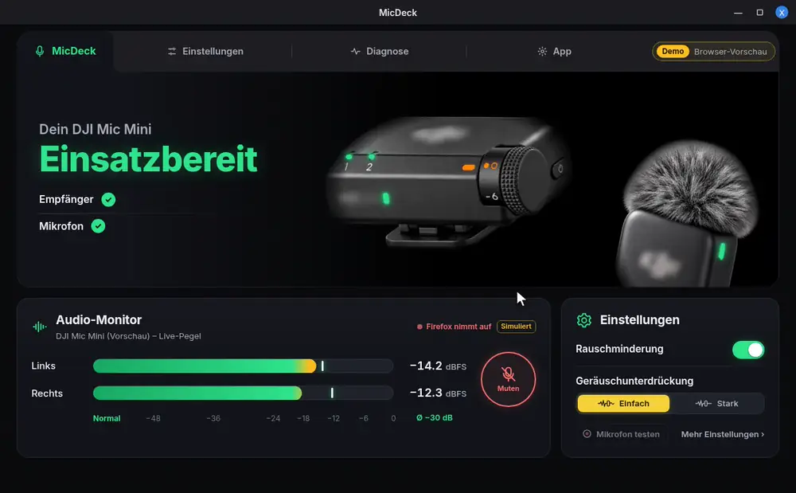
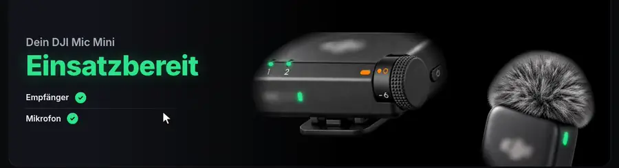
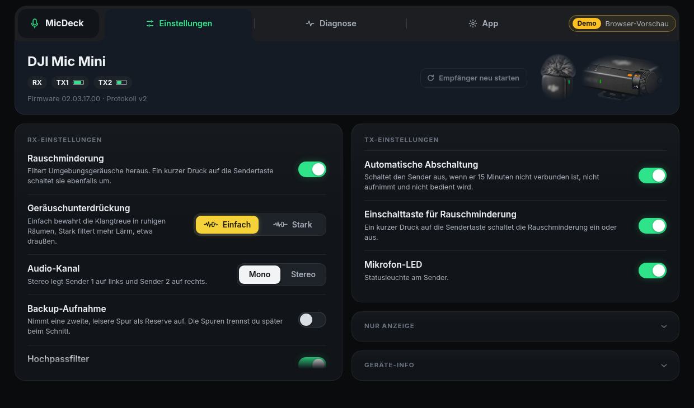
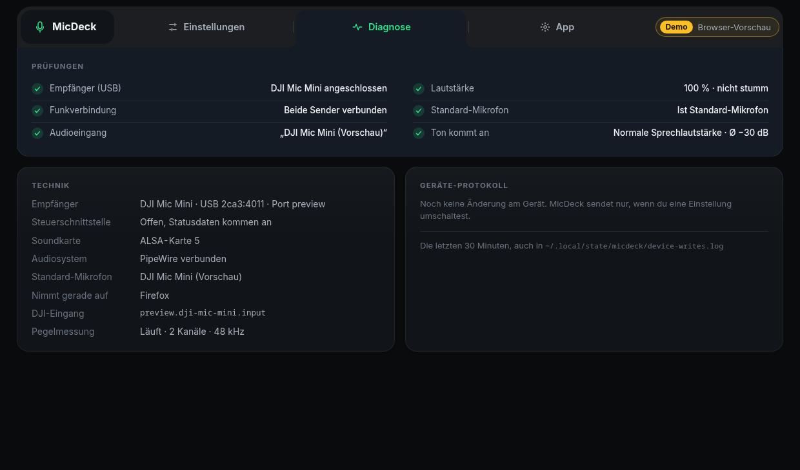
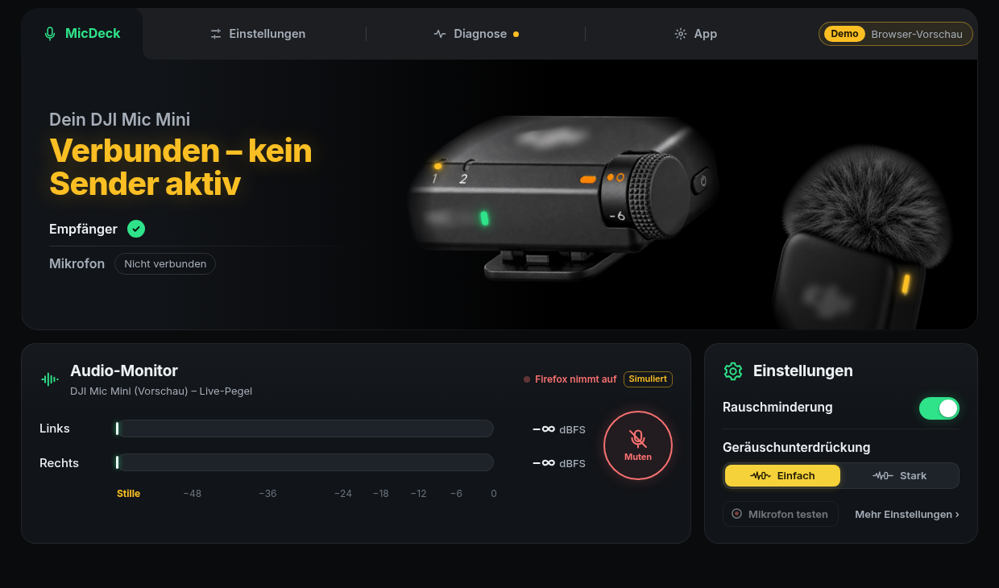
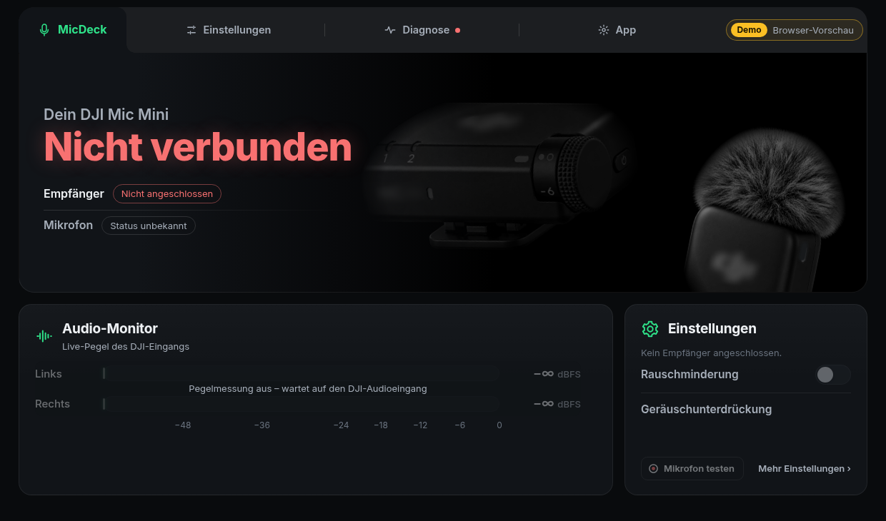

# MicDeck <a href="README.en.md"></a><a href="README.md"></a>

**Die Linux-App zum DJI Mic Mini: Ein Blick zeigt dir, ob Empfänger und Mikro an sind und ob wirklich Ton am PC ankommt.**

<p align="center">   </p>

<p align="center"></p>

DJI hat für das Mic Mini keine Linux-App. MicDeck füllt die Lücke: Es liest den Empfänger über USB, schaut in PipeWire nach, ob der Ton wirklich ankommt, und fasst alles zu einer Ampel zusammen. Grün heißt: Reden, es läuft. Dazu schaltest du Rauschminderung, Mono/Stereo und Co. wie in der DJI-App, nur eben am PC.

> **Inoffiziell und auf eigene Gefahr.** MicDeck ist ein unabhängiges Hobbyprojekt, nicht von DJI oder Anthropic. „DJI“ und „DJI Mic Mini“ stehen hier nur, um das Gerät zu benennen. MicDeck kann Einstellungen an Empfänger und Sender ändern. Es sendet nur Befehle, die am echten Gerät getestet wurden, eine Gewährleistung gibt es aber nicht (siehe Lizenzen).

<details>
<summary><b>🚀 Schnellstart</b></summary>

Fertige Pakete gibt es noch nicht. Ein RPM für Fedora baust du so:

```bash
sudo dnf install webkit2gtk4.1-devel librsvg2-devel libxdo-devel pipewire-devel clang rust cargo nodejs
npm install --global pnpm    # falls pnpm noch fehlt
pnpm -C app install
pnpm -C app tauri build --bundles rpm
sudo dnf install target/release/bundle/rpm/MicDeck-*.rpm
```

Danach Empfänger einstecken, MicDeck aus dem Menü starten, fertig. Unter Cinnamon zeigt MicDeck sich am schönsten als Applet: Rechtsklick aufs Panel → **Applets** → **MicDeck** hinzufügen. Ohne Applet erscheint ein normales Panel-Symbol.

**Du bist ein entspannter Typ oder ein entspanntes Girl?** Dann gib einfach diesen Prompt an deinen KI-Agenten (z. B. Claude Code oder Codex auf deinem PC). Er schaut nach, was schon da ist und was fehlt, und fragt dich bei allem, was er ändern will.

```text
Hilf mir, MicDeck (github.com/Hendrik4K/micdeck) auf diesem Linux-PC einzurichten, damit ich mein DJI Mic Mini am PC überwachen und einstellen kann.
Prüfe zuerst nur und frag mich vor jeder Änderung:
1. Welche Distribution und welcher Desktop laufen hier? Läuft PipeWire mit WirePlumber (`wpctl status`)?
2. Sind Rust ab 1.90, Node.js, pnpm, clang und die Entwicklungspakete für WebKitGTK 4.1, librsvg, libxdo und PipeWire installiert? Sag mir, was fehlt und mit welchem Befehl ich es nachinstalliere. `sudo`-Befehle führst du erst nach meinem OK aus, das Passwort tippe ich selbst.
3. Klone das Repository, führe `cargo test --workspace` aus und baue danach mit `pnpm -C app install` und `pnpm -C app tauri build --bundles rpm` das Paket (auf Fedora; sonst sag mir, welches Paketformat passt).
4. Installiere das Paket erst nach meinem OK. Es bringt eine udev-Regel mit, die nur dem angemeldeten Benutzer Zugriff auf den Empfänger gibt.
5. Stecke ich den Empfänger ein, prüf mit `lsusb | grep 2ca3`, ob er erkannt wird, und mit `wpctl status`, ob sein Audioeingang da ist.
6. Nutze ich Cinnamon, erklär mir, wie ich das MicDeck-Applet zum Panel hinzufüge. Ändere keine Panel-Einstellungen selbst.
7. Sag mir am Ende, wie ich MicDeck starte und woran ich sehe, dass alles grün ist.
```

**Selbst bauen und entwickeln (für Bastler):** Rust ab 1.90 und Node.js mit pnpm, dann im Projektordner:

```bash
pnpm -C app install
cargo test --workspace
pnpm -C app tauri dev                 # mit echtem Empfänger
pnpm -C app tauri dev -- -- --demo    # Demo-Modus ohne Gerät
pnpm -C app dev                       # nur die Oberfläche im Browser, http://127.0.0.1:1420
```

Ohne das Paket `clang` findet libclang beim Bauen der PipeWire-Anbindung seine eigenen Header (`stdbool.h`) nicht. Als Notlösung zeigt `.cargo/config.toml` auf `/usr/lib/clang/22/include`; passe die Zahl an, wenn deine clang-Version anders ist.

</details>

<details>
<summary><b>💡 Was es kann</b></summary>

- **Ampel auf einen Blick**<br>Grün (einsatzbereit), Gelb (verbunden, aber z. B. stumm, kein Ton oder nicht das Standard-Mikrofon), Rot (nicht verbunden). Zu jedem Zustand gibt es eine Prüfliste und einen konkreten Tipp.
- **Menü im Panel, wenn du drüberfährst**<br>Unter Cinnamon geht beim Drüberfahren ein Menü auf: Status, Live-Pegel, Stummschalten und die wichtigsten Schalter. Ein Klick aufs Symbol öffnet MicDeck. Nimmt gerade ein Programm auf, pulsiert das Symbol.
- **Geräteeinstellungen wie in der DJI-App**<br>Rauschminderung (an/aus, Einfach/Stark), Mono/Stereo, Backup-Aufnahme, Hochpassfilter, Clipping-Kontrolle, automatische Abschaltung, Empfänger mit der Kamera ein- und ausschalten, Sendertaste, Mikrofon-LED. Eine Änderung zählt erst, wenn der Empfänger sie bestätigt **und** den neuen Wert zurückmeldet.
- **Live-Pegel**<br>In dBFS, mit Übersteuerungsanzeige und Lautstärke in Worten („Flüsterleise“ … „Sehr laut“). Gemessen wird nur im Arbeitsspeicher, solange eine Anzeige sichtbar ist.
- **Großer Stumm-Knopf**<br>Schaltet den Schalter im Empfänger selbst um. Dann kommt bei keinem Programm mehr Ton an. Hebt ein anderes Programm die Stummschaltung auf, warnt MicDeck.
- **Mikrofontest**<br>Einfach reden: MicDeck nimmt auf, bis du eine kurze Pause machst, und spielt es dir vor. Nichts wird gespeichert.
- **Ladecase-Tricks**<br>Zeigt „lädt“, wenn der Sender im Case liegt. Optional: Im Case stumm schalten. Und experimentell: Sender raus startet das Diktat in der Claude-App, Sender rein schickt die Nachricht ab.
- **Einstecken, abziehen, wieder einstecken**<br>Alles im laufenden Betrieb, ohne Neustart.
- **Eigene Gerätebilder**<br>MicDeck bringt Bilder von Empfänger und Sender mit (KI-generiert, Logos weichgezeichnet). Bleib etwa 5 Sekunden mit der Maus auf einem Gerät, bis sich der Kreis schließt, dann „PNG hochladen“ klicken und dein eigenes Foto einsetzen. „Standard“ holt das mitgelieferte Bild zurück.

<ins>Warum es das gibt:</ins> DJI liefert keine Linux-App, und die vorhandenen Community-Tools ([DJI-Mic-Control](https://github.com/ShadowBitBasher/DJI-Mic-Control), [dji-mic-mo](https://github.com/usokawa/dji-mic-mo)) sprechen zwar mit dem Empfänger, prüfen aber nicht den Teil, der unter Linux meistens hakt: ob der Ton wirklich bei PipeWire ankommt.

</details>

<details>
<summary><b>📷 Mehr Bilder</b></summary>

<p align="center"></p>

<p align="center"></p>

| Geräteeinstellungen | Diagnose |
|---|---|
|  |  |
| **Empfänger an, kein Sender** | **Nicht verbunden** |
|  |  |

*Alle Bilder und Animationen zeigen Demo-Daten aus der Browser-Vorschau, keine echten Messwerte. Desktop und Panel in der ersten Animation sind nachgestellt.*

</details>

<details>
<summary><b>🧰 Voraussetzungen</b></summary>

**Getestet:** DJI Mic Mini (Empfänger USB `2ca3:4011`, Firmware 02.03.17.00 und früher 01.01.00.56), ein Sender, Fedora 44 mit Cinnamon auf X11, PipeWire 1.6, WirePlumber 0.5.

**Nicht getestet:** DJI Mic Mini 2 / 2S, zwei Sender gleichzeitig, Wayland, andere Desktops. Rückmeldungen und Fixes sind willkommen.

**USB-Zugriff:** Ton und Pegel funktionieren ohne. Für die Statusdaten des Empfängers (Sender verbunden, Akku, Einstellungen) braucht MicDeck Zugriff auf genau dieses USB-Gerät. Das RPM installiert dafür `packaging/70-micdeck.rules`, die den Zugriff nur dem gerade angemeldeten Benutzer gibt (`uaccess`), ohne `0666` und ohne extra Gruppe. Von Hand:

```bash
sudo install -m 0644 packaging/70-micdeck.rules /etc/udev/rules.d/70-micdeck.rules
sudo udevadm control --reload-rules
sudo udevadm trigger --subsystem-match=usb --attr-match=idVendor=2ca3
```

**Für das Diktat über das Ladecase:** X11, die Claude-Desktop-App und deren Diktat-Kürzel auf dem Standard **Strg+D**.

</details>

<details>
<summary><b>🎛️ Bedienung im Detail</b></summary>

- **Seiten:** *MicDeck* (Gerätebühne, Audio-Monitor mit Stumm-Knopf und Mikrofontest, Schnelleinstellungen), *Einstellungen*, *Diagnose* und *App*. `micdeck --page=device` öffnet eine Seite direkt (`overview`, `device`, `diagnose`, `app`).
- **Panel:** Mit dem Cinnamon-Applet öffnet Drüberfahren das Menü, ein Klick aufs Symbol, aufs Bild oder aufs Zahnrad öffnet MicDeck. Ohne Applet gibt es ein normales Panel-Symbol mit Menü per Rechtsklick. Fenster schließen versteckt MicDeck ins Panel.
- **Was MicDeck nie sendet:** Externer Lautsprecher ohne Stecker (startet den Empfänger neu, bitte in der DJI-App ändern), Klangfarbe (nur Mic Mini 2), Verstärkung (nur am Drehrad, wird angezeigt), Firmware-Updates (nur DJI-App). Dazu gelten dieselben Regeln wie in der DJI-App: Backup-Aufnahme nur in Mono, Einfach/Stark nur mit eingeschalteter Rauschminderung, Sender-Einstellungen nur mit eingeschaltetem Sender. Mit nur einem Sender bleibt MicDeck auf Mono.
- **Geräte-Protokoll:** Jeder Schritt einer Änderung steht 30 Minuten lang unter *Diagnose* und in `~/.local/state/micdeck/device-writes.log`.
- **Eigene Gerätebilder:** Maus 5 Sekunden auf dem Gerät lassen, „PNG hochladen“ wählen (auch WebP oder JPEG, am besten freigestellt, höchstens 10 MB). MicDeck kopiert das Bild nach `~/.config/micdeck/devices/`, das Original darf danach weg. Das vorige Bild bleibt dort als `receiver-vorher.png` bzw. `transmitter-vorher.png`. Von Hand geht es auch: `receiver.png` und `transmitter.png` in den Ordner legen und MicDeck neu starten. Wo die Statuslämpchen sitzen, sagt eine optionale `leds.json` im selben Ordner, in Prozent des Bildes:
  `{"receiver": {"power": [25, 56], "unit1": [13, 24], "unit2": [22, 27]}, "transmitter": {"status": [76, 56]}}`
- **Im Ladecase stumm:** Sender 1 ins Case schaltet stumm, rausnehmen hebt es auf. Will in der Zeit ein Programm aufnehmen (etwa der Browser), gibt MicDeck das Mikro nur dafür frei und schaltet 2 s danach wieder stumm. Eine Stummschaltung per Knopf hebt MicDeck nie auf.
- **Diktat über das Ladecase (experimentell):** Sender 1 raus holt das Claude-Fenster nach vorn und drückt Strg+D. Sender rein wartet 1 s aufs Satzende, drückt Strg+D, wartet 2 s auf den Text und schickt mit Enter ab. Tasten gehen nur ans Claude-Fenster; lässt es sich nicht nach vorn holen, passiert nichts.
- **Beim Anmelden starten** legt `~/.config/autostart/micdeck.desktop` an (startet nur im Panel) und entfernt ihn beim Ausschalten wieder. Einstellungen liegen in `~/.config/micdeck/settings.json`.
- **Demo-Modus:** `micdeck --demo` zeigt alle zwölf Szenarien, `micdeck --demo=no-transmitter` eins davon.
- **Fehlersuche:** `RUST_LOG=info,usb_link=debug,audio_pw=debug micdeck`; mit `usb_link=trace` siehst du jedes Statuspaket des Empfängers als Hex.

</details>

<details>
<summary><b>🔒 Datenschutz</b></summary>

Keine Konten, keine Cloud, keine Telemetrie. Der Ton wird nur für die Pegelanzeige und den Mikrofontest im Arbeitsspeicher verarbeitet und nie gespeichert oder verschickt. Auf das Gerät schreibt MicDeck nur Einstellungen, die du selbst umschaltest, und nie Firmware.

</details>

<details>
<summary><b>🧪 Teststand</b></summary>

| Teil | Stand |
|---|---|
| Automatische Tests (Protokoll, Ampel-Regeln, Sperrregeln, Pegel, Spracherkennung, PipeWire, Ladecase) | ✅ 115 bestanden |
| Alle 11 schaltbaren Einstellungen am echten Gerät umgeschaltet und zurückgestellt, jede bestätigt und nach 0,1–0,2 s zurückgelesen | ✅ Firmware 02.03.17.00 |
| Einstecken, Abziehen, Wiedereinstecken im laufenden Betrieb | ✅ am Gerät |
| Stumm-Knopf schaltet den Schalter im Empfänger, Warnung bei fremdem Entstummen | ✅ am Gerät |
| Diktat über das Ladecase mit der Claude-App | ✅ am Gerät |
| Cinnamon-Applet: Menü beim Drüberfahren, Klick öffnet MicDeck, Pegel live | ✅ Cinnamon 6.6 |
| Zwei Sender gleichzeitig, echte Programme wie OBS oder Discord parallel | ⏳ noch nicht getestet |

Den Weg zum Gerät prüfst du selbst mit `cargo run -p usb-link --example settings_roundtrip` (MicDeck vorher beenden; jeder Wert wird wiederhergestellt).

</details>

<details>
<summary><b>🛠️ Aufbau und Protokoll</b></summary>

```
crates/dji-protocol   DJI-Statusprotokoll (aus DJI-Mic-Control übernommen, siehe THIRD_PARTY.md)
crates/micdeck-core   Zustand, Ampel-Regeln, Pegel-Mathematik, Demo-Szenarien, ohne Hardwarezugriff
crates/usb-link       USB: Hotplug, Rechte, Statusdaten lesen, Einstellungen schreiben
crates/audio-pw       PipeWire: Eingänge, Standard-Mikrofon, stumm, Pegelmessung
app/src-tauri         Tauri-App, Panel, D-Bus-Schnittstelle fürs Applet, Diktat
app/src               Oberfläche (Svelte 5 + TypeScript)
packaging/            udev-Regel, Cinnamon-Applet
docs/                 Protokoll, Bilder
```

Das Statusprotokoll des Empfängers steht in [docs/protocol/PROTOCOL.md](docs/protocol/PROTOCOL.md) (aus DJI-Mic-Control). MicDeck ergänzt einen Fund vom echten Gerät: Bei Firmware v1 ist Bit `0x02` im Flag-Byte eines Senders gesetzt, solange er im Ladecase liegt (`0x26` drin, `0x24` draußen), dasselbe Bit, das Firmware v2 als „lädt“ meldet.

</details>

## Lizenz

MicDeck steht wahlweise unter [MIT](LICENSE-MIT) oder [Apache-2.0](LICENSE-APACHE). `crates/dji-protocol` ist The Unlicense (gemeinfrei), wie im Original. Fremde Bestandteile, die KI-generierten Bilder und was geändert wurde, stehen in [THIRD_PARTY.md](THIRD_PARTY.md).
